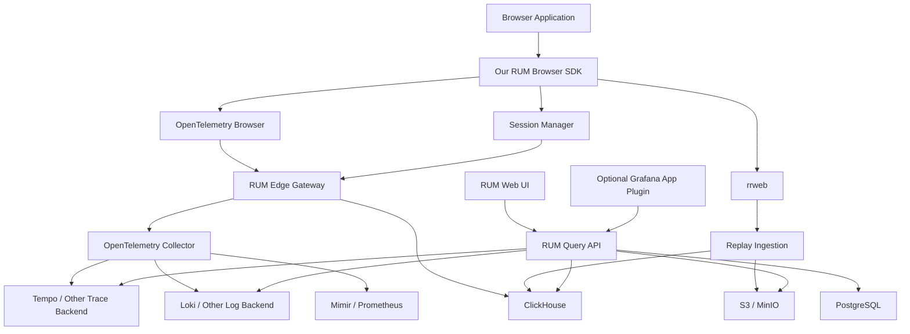

# OTel-Native RUM Platform

Working title. The final project and product name should be selected after checking package names, domains, trademarks, and existing open-source projects.

**Status:** Pre-alpha / architecture phase
**Core philosophy:** OpenTelemetry-native, privacy-first, self-hostable, backend-aware, fully open source.

---

## 1. What Are We Building?

We are building a fully open-source Real User Monitoring platform around OpenTelemetry.

The project combines:

- OpenTelemetry Browser instrumentation
- distributed tracing
- browser errors
- console telemetry
- Web Vitals
- navigation and resource performance
- sessions
- session replay using rrweb
- source-map symbolication
- frontend-to-backend correlation
- RUM analytics
- customizable instrumentation
- self-hosted deployment
- managed deployment
- eventually, open-source anomaly detection

The long-term goal is not merely:

> "An open-source session replay tool."

Nor is it merely:

> "A Grafana dashboard for browser telemetry."

The goal is:

> A complete OpenTelemetry-native RUM platform capable of competing with products such as Datadog RUM, Sentry, Grafana Frontend Observability, OpenReplay, and similar commercial platforms while remaining deployable entirely on infrastructure controlled by the customer.

---

## 2. The Vision

A developer should be able to go from this:

```
npm install @our-project/browser
```

to understanding:

```
A user in Chrome
        │
        │ opened /checkout
        ▼
LCP = 4.1 seconds
        │
        │ clicked "Pay"
        ▼
Frontend exception
        │
        ├──────────── Session Replay
        │
        └──────────── Browser Event
                              │
                              ▼
                       POST /payment
                              │
                           trace.id
                              │
                              ▼
                       Backend API
                              │
                              ▼
                        PostgreSQL
```

from one interface.

The developer should be able to answer:

- What happened?
- Which users experienced it?
- What did the browser do?
- What did the user do?
- What network request occurred?
- What backend operation caused the delay?
- Can I replay the exact session?
- Did this start after the latest release?
- Is this affecting all users or only Safari?
- Is this an isolated incident or an emerging anomaly?

---

## 3. Why Build This?

Modern observability has become increasingly standardized around OpenTelemetry on the backend.

Frontend observability remains considerably more fragmented.

A typical organization may currently have:

```
Browser telemetry     → Sentry
Session replay        → FullStory / rrweb / another platform
Frontend metrics      → Grafana
Backend traces        → Tempo
Backend logs          → Loki
Metrics               → Prometheus / Mimir
Product analytics     → another platform
```

The context becomes fragmented.

We want:

```
                         session.id
                             │
              ┌──────────────┼──────────────┐
              │              │              │
              ▼              ▼              ▼
           Browser         Replay         Errors
              │
              │ trace.id
              ▼
           Backend
              │
        ┌─────┼─────┐
        ▼     ▼     ▼
      logs  traces metrics
```

with one consistent correlation model.

---

## 4. Why OpenTelemetry?

OpenTelemetry provides something more strategically valuable than another proprietary RUM SDK:

**an industry-standard telemetry model.**

Our goal is therefore:

> OTel-native, not merely OTel-compatible.

The canonical concepts should remain:

- OTLP
- trace_id
- span_id
- resource attributes
- span attributes
- LogRecords
- Metrics
- OpenTelemetry semantic conventions
- W3C Trace Context

Our internal product may introduce additional RUM concepts where OpenTelemetry has not standardized them yet, but those additions should be intentionally designed so they can eventually align with upstream standards.

The OpenTelemetry Browser project is now the dedicated home for browser instrumentation and the future browser SDK, with browser performance and user-interaction instrumentation increasingly represented as structured events. (GitHub)

---

## 5. Product Principles

### 5.1 OpenTelemetry First

Do not invent proprietary telemetry representations when OpenTelemetry already provides an appropriate model.

### 5.2 Fully Open Source

A company must be able to operate the complete platform without sending telemetry to infrastructure controlled by us.

### 5.3 Data Sovereignty

Customers should be able to run the system:

- on-premises
- AWS
- Azure
- GCP
- Hetzner
- private Kubernetes
- air-gapped infrastructure
- their own object storage
- their own observability backend

### 5.4 Backend-Agnostic Where Practical

The product should work extremely well with:

- Grafana
- Tempo
- Loki
- Mimir
- Prometheus

but it should not require Grafana.

Future integrations may include:

- Jaeger
- ClickHouse
- Elastic
- VictoriaMetrics ecosystem
- SigNoz
- Honeycomb
- other OTLP-compatible systems

### 5.5 Privacy by Default

RUM can accidentally capture extremely sensitive data.

Therefore:

> privacy > convenience

Replay and network capture must be designed around explicit masking and allowlisting rather than unrestricted capture.

### 5.6 Browser SDK Must Stay Small

Do not turn the browser package into the entire product.

The SDK should primarily provide:

- instrumentation
- session lifecycle
- correlation
- sampling
- privacy
- buffering
- transport

Complex analytics belong server-side.

### 5.7 No Reinventing Commodity Infrastructure

Use mature projects where they solve the problem well.

Examples:

```
OpenTelemetry → telemetry
rrweb         → DOM recording/replay
ClickHouse    → analytical queries
PostgreSQL    → control-plane metadata
S3/MinIO      → replay/source-map objects
Grafana       → optional visualization/integration
```

Our engineering effort should focus on the pieces that make these technologies operate as a cohesive RUM product.

---

## 6. Product Architecture



---

## 7. Core Components

The platform should initially be divided into the following components.

### 7.1 Browser SDK

Possible package:

```
@project/browser
```

Responsibilities:

- OTel initialization
- session lifecycle
- view lifecycle
- browser identity
- anonymous user identity
- trace propagation
- Web Vitals
- navigation instrumentation
- fetch/XHR instrumentation
- errors
- console telemetry
- resource timing
- user interaction events
- rrweb recording
- privacy masking
- sampling
- buffering
- retry logic
- transport
- SDK diagnostics

The SDK should wrap rather than fork OpenTelemetry wherever possible.

---

## 8. Browser SDK Architecture

```
@project/browser
│
├── core
│   ├── configuration
│   ├── lifecycle
│   ├── context
│   └── diagnostics
│
├── session
│   ├── session.id
│   ├── user.id
│   ├── view.id
│   └── lifecycle
│
├── telemetry
│   ├── OpenTelemetry Browser
│   ├── Web Vitals
│   ├── navigation
│   ├── resource timing
│   ├── fetch
│   ├── XHR
│   ├── errors
│   └── console
│
├── replay
│   ├── rrweb
│   ├── chunker
│   ├── compressor
│   ├── uploader
│   └── privacy
│
├── sampling
│   ├── session sampling
│   ├── replay sampling
│   ├── error-triggered replay
│   └── dynamic sampling
│
└── transport
    ├── OTLP
    ├── replay transport
    ├── retry
    └── offline buffer
```

---

## 9. The Golden Correlation Model

The most important cross-system correlation key should be:

```
session.id
```

Additional IDs:

```
user.id
view.id
trace_id
span_id
release.id
deployment.environment
```

Example:

```
session.id = 01M4X...
view.id    = 01M4Y...
user.id    = anonymous-4812
trace_id   = 7ab2...
```

Then:

```
Session
│
├── Web Vital
│      session.id
│
├── Click
│      session.id
│
├── JavaScript Error
│      session.id
│
├── Console Error
│      session.id
│
├── Replay Chunk
│      session.id
│
└── Fetch Span
       session.id
       trace_id
          │
          ▼
       API Span
          │
          ▼
       DB Span
```

This relationship is fundamental to the product.

---

## 10. Session Lifecycle

A session should not simply mean "browser tab exists."

We must define explicit rules.

Possible first specification:

```
session starts
    ↓
page load
    ↓
activity
    ↓
route changes
    ↓
activity
    ↓
inactivity timeout
    ↓
session ends
```

The exact timeout should be configurable.

The platform should distinguish:

- user
- session
- view
- navigation
- interaction
- trace

These are not equivalent concepts.

---

## 11. View Model

Single-page applications require their own logical page concept.

Example:

```
session
│
├── view: /
│
├── view: /products
│
├── view: /products/123
│
└── view: /checkout
```

Every relevant RUM event should be attachable to:

```
session.id
view.id
```

---

## 12. Telemetry Signals

### Browser Performance

Capture:

- LCP
- CLS
- INP
- TTFB
- FCP
- navigation timing
- resource timing
- long tasks
- page lifecycle

### Network

Capture:

- fetch
- XHR
- HTTP method
- URL template where possible
- duration
- status code
- request size
- response size
- trace context

Sensitive headers and bodies must not be captured by default.

### Errors

Capture:

- uncaught exceptions
- unhandled promise rejections
- resource loading errors
- console errors
- network failures

### User Interaction

Initial set:

- click
- navigation
- form submission
- route transition

Avoid recording arbitrary user input as telemetry.

### Environment

Useful dimensions:

- browser
- browser.version
- OS
- device class
- viewport
- language
- timezone
- connection type
- release
- environment
- application version

---

## 13. Session Replay

Session replay should use rrweb, rather than implementing DOM recording ourselves.

rrweb is MIT licensed and specifically designed around recording and replaying browser interaction. (GitHub)

Architecture:

```
Browser
   │
 rrweb
   │
   ▼
Replay Chunker
   │
 compression
   │
   ▼
Replay Gateway
   │
   ▼
Object Storage
```

Replay should not be transported as OpenTelemetry logs.

DOM mutations are not observability events.

They should remain a dedicated replay stream.

Correlation happens through:

```
session.id
view.id
timestamp
```

---

## 14. Replay Chunking

Never wait until a session finishes before uploading the entire recording.

Proposed model:

```
session
│
├── chunk-0001
├── chunk-0002
├── chunk-0003
└── chunk-0004
```

Metadata:

```json
{
  "session_id": "...",
  "view_id": "...",
  "sequence": 4,
  "start_timestamp": "...",
  "end_timestamp": "...",
  "encoding": "...",
  "compression": "...",
  "schema_version": 1
}
```

Object-storage layout could resemble:

```
replays/
  project-id/
    yyyy/mm/dd/
      session-id/
        metadata.json
        000001.bin
        000002.bin
        000003.bin
```

---

## 15. Replay Timeline

The replay player should eventually present an integrated timeline:

```
00:00 ───────────── session begins
00:04 ───────────── LCP 3.4s
00:07 ───────────── user click
00:08 ───────────── GET /cart
00:15 ───────────── route /checkout
00:29 ───────────── user click "Pay"
00:30 ───────────── POST /payment
00:33 ───────────── HTTP 500
00:33 ───────────── TypeError
00:34 ───────────── backend trace failure
```

Markers should be clickable.

---

## 16. Source Maps

Source maps are a critical debugging feature.

Without symbolication:

```
TypeError
bundle.123.js:1:187231
```

With symbolication:

```
TypeError: paymentIntent is undefined
src/components/CheckoutButton.tsx
Line 147
Column 18
```

Required components:

```
CLI or CI uploader
        │
        ▼
Source Map API
        │
        ▼
Object Storage
        │
        ▼
Symbolication Service
        │
        ▼
Error Processing Pipeline
```

Source maps should be indexed by something equivalent to:

- application
- release
- bundle filename
- debug identifier

---

## 17. RUM Edge Gateway

Do not expose a general-purpose privileged OpenTelemetry Collector directly to arbitrary browsers.

The internet-facing RUM gateway must treat every browser as untrusted.

Responsibilities:

- project identification
- Origin validation
- CORS
- schema validation
- payload-size limits
- rate limiting
- abuse protection
- tenant isolation
- PII scrubbing
- sampling
- compression
- request accounting
- SDK compatibility checks

The browser project token must be treated as:

> PUBLIC IDENTIFIER

not:

> SECRET API KEY

because users can inspect browser code.

---

## 18. Storage Architecture

### PostgreSQL

Use for control-plane data:

- organizations
- projects
- users
- roles
- API configuration
- SDK configuration
- retention configuration
- sampling policies
- source-map metadata
- deployment metadata

### ClickHouse

Use for high-cardinality RUM analytics.

Examples:

- sessions
- views
- browser events
- errors
- performance measurements
- session summaries
- release comparisons
- journey data

Example query:

```sql
SELECT
    browser_name,
    quantile(0.75)(lcp)
FROM rum_views
WHERE
    route = '/checkout'
    AND timestamp > now() - INTERVAL 24 HOUR
GROUP BY browser_name;
```

### Object Storage

Use S3-compatible storage for:

- rrweb chunks
- source maps
- large diagnostic artifacts
- future profiles/artifacts

Supported target:

- AWS S3
- MinIO
- compatible object stores

### Observability Backends

OTel data may additionally be exported to:

- Tempo
- Loki
- Mimir
- Prometheus
- other OTLP-compatible backends

---

## 19. Why Not Put Everything in Loki?

Queries such as:

```
Find sessions where:
browser = Safari
AND route = /checkout
AND LCP > 2500 ms
AND error = true
AND release = 4.81.2
```

are analytics queries.

Likewise:

```
conversion funnel:
landing page
    ↓
product
    ↓
cart
    ↓
checkout
    ↓
success
```

These workloads fit an analytical database considerably better than treating all RUM information as logs.

---

## 20. Control Plane vs Data Plane

Keep them conceptually separate.

```
CONTROL PLANE
users
organizations
projects
tokens
configurations
retention
sampling
RBAC
```

versus:

```
DATA PLANE
telemetry
sessions
replays
errors
performance measurements
analytics
```

This separation will make enterprise deployments significantly easier later.

---

## 21. MVP Definition

The MVP should prove one complete debugging workflow.

### North-Star Demo

A deliberately broken demo shop should exist.

User:

```
opens storefront
```

System shows:

```
LCP = 4.1s
```

User:

```
opens product
adds item
opens checkout
clicks Pay
```

Then:

```
frontend exception
POST /payment = 500
backend trace
slow database call
```

Developer opens the RUM UI and can:

```
find session
     ↓
open timeline
     ↓
watch replay
     ↓
see frontend error
     ↓
see network request
     ↓
open distributed trace
     ↓
identify backend cause
```

If the project can demonstrate this cleanly, the architecture has proven its central hypothesis.

---

## 22. MVP Must-Have Features

- [ ] Browser SDK initialization
- [ ] Project configuration
- [ ] Session creation
- [ ] Session persistence
- [ ] View tracking
- [ ] Web Vitals
- [ ] JavaScript errors
- [ ] Promise rejection tracking
- [ ] fetch instrumentation
- [ ] XHR instrumentation
- [ ] trace-context propagation
- [ ] frontend → backend tracing
- [ ] basic console telemetry
- [ ] browser/device metadata
- [ ] rrweb recording
- [ ] replay chunk upload
- [ ] replay playback
- [ ] session list
- [ ] session search
- [ ] event timeline
- [ ] error markers
- [ ] request markers
- [ ] Web Vital markers
- [ ] trace links
- [ ] privacy masking
- [ ] basic sampling
- [ ] Docker deployment
- [ ] demo application
- [ ] documentation
- [ ] telemetry generated by the platform itself

---

## 23. Explicit MVP Non-Goals

Do not attempt these before the basic vertical slice works:

- heatmaps
- funnels
- AI root-cause analysis
- complex anomaly detection
- mobile native RUM
- co-browsing
- synthetic monitoring
- feature flags
- A/B experimentation
- full product analytics
- complex billing
- multi-region SaaS
- hundreds of integrations

Those can come later.

---

## 24. MVP Acceptance Criteria

The MVP is considered complete when a developer can:

- [ ] deploy the entire platform locally
- [ ] create a project
- [ ] copy an SDK configuration
- [ ] instrument a demo web application
- [ ] generate a browser session
- [ ] find that session
- [ ] inspect page performance
- [ ] inspect browser errors
- [ ] inspect HTTP requests
- [ ] watch the replay
- [ ] click from the replay/session into a distributed trace
- [ ] identify the corresponding backend operation
- [ ] verify sensitive DOM elements were masked
- [ ] verify replay can be disabled independently of telemetry
- [ ] configure sampling
- [ ] delete a session and its replay data

---

## 25. Implementation Roadmap

### Milestone 0 — Foundation

**Repository**

- [ ] choose project name
- [ ] create GitHub organization
- [ ] create monorepo
- [ ] establish semantic versioning
- [ ] establish release process
- [ ] add SECURITY.md
- [ ] add CONTRIBUTING.md
- [ ] add CODE_OF_CONDUCT.md
- [ ] add GOVERNANCE.md
- [ ] add DCO process
- [ ] add dependency scanning
- [ ] add secret scanning
- [ ] add SBOM generation
- [ ] add vulnerability scanning
- [ ] add CI
- [ ] add unit-test framework
- [ ] add integration-test environment

**Architecture**

- [ ] ADR: licensing
- [ ] ADR: ClickHouse
- [ ] ADR: PostgreSQL
- [ ] ADR: object storage
- [ ] ADR: session model
- [ ] ADR: replay format
- [ ] ADR: ingestion protocol
- [ ] ADR: UI architecture
- [ ] ADR: deployment architecture

### Milestone 1 — Browser SDK

- [ ] initialize OpenTelemetry Browser
- [ ] implement configuration API
- [ ] implement project ID
- [ ] implement session ID
- [ ] implement view ID
- [ ] implement anonymous user ID
- [ ] implement session persistence
- [ ] implement session expiration
- [ ] implement SPA navigation detection
- [ ] capture Web Vitals
- [ ] capture runtime exceptions
- [ ] capture unhandled rejections
- [ ] instrument fetch
- [ ] instrument XHR
- [ ] propagate traceparent
- [ ] attach session.id to relevant telemetry
- [ ] attach view.id
- [ ] attach release metadata
- [ ] attach environment metadata
- [ ] browser diagnostics
- [ ] SDK version attribute
- [ ] payload batching
- [ ] retry/backoff
- [ ] unload handling
- [ ] sampling
- [ ] privacy configuration

**SDK Target API**

Possible future API:

```ts
import { initRUM } from "@project/browser";

initRUM({
  endpoint: "https://rum.example.com",
  projectId: "web-store",
  service: {
    name: "storefront",
    version: "1.4.2",
    environment: "production",
  },
  tracing: {
    enabled: true,
    propagateTo: [
      "https://api.example.com",
    ],
  },
  replay: {
    enabled: true,
    sampleRate: 0.10,
  },
  privacy: {
    maskInputs: true,
  },
});
```

This is a design target, not a committed API.

### Milestone 2 — RUM Gateway

Recommended first implementation language:

**Go**

Reasons include:

- simple deployment
- low memory overhead
- good concurrency
- excellent OpenTelemetry ecosystem
- single binaries
- strong networking support

TODO:

- [ ] HTTP ingestion API
- [ ] OTLP/HTTP support
- [ ] replay ingestion endpoint
- [ ] project identification
- [ ] Origin validation
- [ ] CORS
- [ ] request-size limits
- [ ] rate limiting
- [ ] tenant boundaries
- [ ] schema validation
- [ ] request telemetry
- [ ] structured logs
- [ ] health endpoint
- [ ] readiness endpoint
- [ ] graceful shutdown
- [ ] backpressure strategy
- [ ] OpenTelemetry instrumentation

### Milestone 3 — Sessionization

- [ ] sessions table
- [ ] views table
- [ ] session event stream
- [ ] session start processing
- [ ] session end inference
- [ ] session summary processing
- [ ] browser metadata normalization
- [ ] release metadata
- [ ] route normalization
- [ ] session search API
- [ ] view search API

Example session summary:

```json
{
  "session_id": "...",
  "started_at": "...",
  "duration_ms": 142023,
  "views": 5,
  "errors": 2,
  "requests": 34,
  "worst_lcp_ms": 3800,
  "browser": "Chrome",
  "device": "desktop",
  "release": "1.4.2",
  "has_replay": true
}
```

### Milestone 4 — Session Replay

- [ ] integrate rrweb recorder
- [ ] configurable masking
- [ ] replay sampling
- [ ] replay chunker
- [ ] compression
- [ ] sequence numbering
- [ ] failed-upload retry
- [ ] object-storage persistence
- [ ] replay metadata
- [ ] replay API
- [ ] integrate rrweb-player
- [ ] seek support
- [ ] event timeline synchronization
- [ ] error markers
- [ ] request markers
- [ ] Web Vital markers
- [ ] trace markers
- [ ] replay deletion

### Milestone 5 — RUM UI

The product should have its own UI.

Grafana integration should be optional rather than the only interface.

Initial navigation:

```
Overview
Sessions
Errors
Performance
Applications
Settings
```

**Sessions**

- [ ] session table
- [ ] filters
- [ ] session details
- [ ] replay
- [ ] event timeline
- [ ] requests
- [ ] browser metadata
- [ ] linked traces

**Errors**

- [ ] error list
- [ ] error details
- [ ] stack trace
- [ ] affected sessions
- [ ] release
- [ ] browser breakdown

**Performance**

- [ ] LCP
- [ ] INP
- [ ] CLS
- [ ] TTFB
- [ ] route breakdown
- [ ] browser breakdown
- [ ] release breakdown

### Milestone 6 — Source Maps

- [ ] source-map upload CLI
- [ ] CI authentication
- [ ] release association
- [ ] source-map object storage
- [ ] source-map index
- [ ] symbolication worker
- [ ] error reprocessing
- [ ] source display
- [ ] code context
- [ ] deletion lifecycle

Target workflow:

```bash
rum-cli sourcemaps upload \
    ./dist \
    --release 1.4.2
```

### Milestone 7 — Deployment

**Docker**

- [ ] Docker images
- [ ] Docker Compose
- [ ] health checks
- [ ] sample configuration
- [ ] persistent volumes
- [ ] upgrade documentation
- [ ] backup documentation

**Kubernetes**

- [ ] Helm chart
- [ ] resource requests
- [ ] probes
- [ ] HPA support
- [ ] ingress configuration
- [ ] object-storage configuration
- [ ] ClickHouse configuration
- [ ] PostgreSQL configuration
- [ ] secret management
- [ ] network policies
- [ ] pod disruption budgets

### Milestone 8 — Production Hardening

- [ ] high availability
- [ ] horizontal gateway scaling
- [ ] replay ingestion scaling
- [ ] ClickHouse partition strategy
- [ ] retention policies
- [ ] TTL policies
- [ ] S3 lifecycle policies
- [ ] data deletion workflow
- [ ] GDPR deletion workflow
- [ ] audit logs
- [ ] RBAC
- [ ] SSO design
- [ ] load testing
- [ ] chaos tests
- [ ] recovery testing
- [ ] backup testing
- [ ] restore testing
- [ ] SLOs
- [ ] operational dashboards
- [ ] alerting
- [ ] capacity documentation

---

## 26. Repository Structure

Suggested starting structure:

```
/
├── README.md
├── CONTRIBUTING.md
├── SECURITY.md
├── GOVERNANCE.md
├── CODE_OF_CONDUCT.md
├── LICENSES/
│
├── AGENTS.md
├── BACKLOG.md
├── tracker.md
│
├── docs/
│   ├── architecture/
│   ├── concepts/
│   ├── deployment/
│   ├── instrumentation/
│   ├── privacy/
│   └── operations/
│
├── adr/
│   ├── README.md
│   ├── 0001-session-model.md
│   ├── 0002-storage.md
│   └── ...
│
├── sdk/
│   └── browser/
│
├── services/
│   ├── gateway/
│   ├── sessions/
│   ├── query-api/
│   ├── symbolicator/
│   └── anomaly/
│
├── web/
│   └── rum-ui/
│
├── integrations/
│   └── grafana/
│
├── deploy/
│   ├── docker/
│   ├── helm/
│   └── terraform/
│
├── schemas/
│   ├── otel/
│   ├── rum/
│   └── replay/
│
├── migrations/
│   ├── clickhouse/
│   └── postgres/
│
├── examples/
│   ├── react/
│   ├── nextjs/
│   └── demo-shop/
│
├── tests/
│   ├── e2e/
│   ├── load/
│   └── compatibility/
│
└── playground/
    ├── opentelemetry-browser/
    ├── rrweb/
    ├── clickhouse/
    ├── grafana-plugin/
    ├── source-maps/
    └── sampling/
```

---

## 27. Playground Philosophy

Before committing important infrastructure choices, build isolated experiments.

Examples:

```
playground/opentelemetry-browser
playground/rrweb
playground/sessionization
playground/clickhouse
playground/source-maps
playground/grafana-plugin
playground/high-volume-replay
playground/privacy
```

Each experiment should answer a concrete question.

Example:

```
Question:
Can rrweb recordings be safely chunked every N seconds
without breaking replay?

Result:
...

Decision:
...

ADR:
...
```

---

## 28. Licensing Strategy

If the goal is fully open source + commercial services, a reasonable structure to evaluate is:

```
Browser SDK
    Apache-2.0
CLI
    Apache-2.0
Server
    AGPL-3.0
Web UI
    AGPL-3.0
Grafana integration
    AGPL-3.0
Documentation
    appropriate open documentation license
```

**Why a permissive SDK?**

Because customers should feel completely safe embedding it into proprietary applications.

**Why consider AGPL for the server?**

Because the company wants:

> open source + commercial sustainability

rather than preventing commercial use entirely.

AGPL still permits commercial use but requires network-deployed modifications to remain available under its terms.

Final licensing must receive proper legal review before public launch.

---

## 29. Open-Core?

Our preferred principle should be:

> The fundamental RUM product remains open source.

Do not intentionally cripple self-hosted installations simply to sell cloud.

The commercial product can sell:

- operation
- convenience
- support
- SLAs
- migration
- compliance
- customization
- scale
- managed upgrades
- managed infrastructure
- training
- consulting

rather than withholding core observability functionality.

---

## 30. Deployment and Commercial Models

The same project can support several offerings.

### Community

```
Customer hosts it
Customer operates it
Price: Free
```

We provide:

- source code
- Docker deployment
- Helm deployment
- documentation
- community support

### Supported Self-Hosted

```
Customer infrastructure
Customer primarily operates it
We support it
```

Possible services:

- installation review
- architecture review
- upgrade guidance
- incident support
- performance tuning
- instrumentation assistance

### Managed BYOC

This may be one of the most attractive enterprise offerings.

```
Customer AWS / Azure / GCP / private cloud
        │
        ▼
Our RUM deployment
        │
        ▼
Customer owns the data
        │
We operate the platform
```

We manage:

- installation
- upgrades
- monitoring
- backups
- capacity
- security updates
- incident response

The customer owns the infrastructure bill.

That helps reduce our infrastructure risk while satisfying data-sovereignty requirements.

### Managed Cloud

Later:

```
Customer
    │
    ▼
Our SaaS
```

This requires significantly more engineering:

- multi-tenancy
- billing
- isolation
- regional deployment
- abuse controls
- large-scale storage
- compliance
- support operations

It should not be necessary for the first commercial customers.

---

## 31. Instrumentation-as-a-Service

This can be an important commercial differentiator.

Instead of saying:

> "Here is the SDK. Good luck."

offer:

> "We will instrument your application properly for you."

Possible services:

- React instrumentation
- Next.js
- Angular
- Vue
- micro-frontends
- frontend/backend trace propagation
- custom business events
- privacy configuration
- PII review
- sampling design
- release tracking
- source-map integration
- dashboards
- alerts
- SLOs

This can generate revenue before a large hosted platform exists.

---

## 32. Observability Consulting Around the Product

Another service line:

- browser → API tracing
- OpenTelemetry architecture
- Collector deployment
- LGTM integration
- ClickHouse tuning
- telemetry cost reduction
- semantic convention design
- custom instrumentation
- dashboard design
- incident workflows

The open-source project can become the entry point for this work.

---

## 33. Is This Business Model Realistic?

Yes.

The model already exists in adjacent observability categories:

```
Open Source
    ↓
Community Adoption
    ↓
Commercial Support
    ↓
Managed Deployment
    ↓
Enterprise Contracts
```

Current examples show companies charging for combinations of self-hosted support, dedicated managed deployments, BYOC and managed cloud.

- OpenReplay currently offers a free self-hosted edition plus managed dedicated deployments, including customer-cloud deployment options. (OpenReplay)
- SigNoz offers Community Edition, managed cloud, dedicated/BYOC environments and self-hosted enterprise support. (SigNoz)
- Grafana currently charges new Frontend Observability customers based on sessions plus telemetry volume, demonstrating direct commercial demand for RUM functionality. (Grafana Labs)

Therefore:

> There is clearly money being spent on this problem.

That does not mean another RUM product automatically becomes profitable.

---

## 34. Profitability Thesis

The project becomes commercially interesting if it establishes several advantages.

### Advantage 1 — Self-Hosting

Some organizations cannot send browser telemetry or session recordings to external SaaS providers.

Those organizations have real purchasing motivation.

### Advantage 2 — OpenTelemetry

Companies already investing in OpenTelemetry may prefer:

- one telemetry model
- one trace context
- one collector ecosystem

over another proprietary SDK.

### Advantage 3 — Frontend ↔ Backend Correlation

Our strongest technical product experience should be:

```
Replay
   ↓
browser error
   ↓
request
   ↓
trace
   ↓
backend span
   ↓
database
```

not merely replay itself.

### Advantage 4 — Instrumentation Support

Many observability products sell software.

We can additionally sell expertise:

> "Give us your application. We will make it observable correctly."

### Advantage 5 — BYOC

Enterprises increasingly care about:

- data locality
- data residency
- privacy
- security
- cost control

BYOC directly addresses those concerns.

---

## 35. What Would Make the Business Fail?

Avoid assuming:

> open source = automatic adoption

It does not.

Major risks include:

- poor UI
- difficult installation
- huge storage consumption
- bad replay reliability
- browser SDK performance overhead
- weak documentation
- privacy incidents
- breaking SDK upgrades
- too many infrastructure dependencies
- no clear differentiation
- trying to clone Datadog feature-for-feature
- support burden
- selling only to developers who never pay

---

## 36. The Business Moat

The moat should not be:

> "Our repository exists."

The moat should become:

- exceptional UX
- excellent OpenTelemetry integration
- excellent session ↔ backend correlation
- easy deployment
- strong privacy controls
- reliable replay
- low browser overhead
- good documentation
- instrumentation expertise
- enterprise operations knowledge
- community
- integration ecosystem

---

## 37. Open Source as Distribution

Think of the open-source project as a distribution channel.

Developer journey:

```
GitHub
  │
  ▼
docker compose up
  │
  ▼
instrument app
  │
  ▼
"this is useful"
  │
  ▼
team adoption
  │
  ▼
production deployment
  │
  ├──── self-managed
  │
  ├──── support contract
  │
  ├──── BYOC management
  │
  └──── managed cloud
```

The commercial goal is not to prevent self-hosting.

The goal is to make:

> running it yourself

and:

> paying experts to operate it

both legitimate choices.

---

## 38. Commercial Metrics

Track:

- GitHub stars
- contributors
- active installations
- SDK npm downloads
- Discord/Slack activity
- organizations evaluating
- production installations
- support customers
- managed customers
- monthly recurring revenue
- gross margin
- support hours/customer
- ingestion volume
- storage/customer
- replay storage/session
- customer acquisition cost
- sales cycle length
- conversion Community → Paid

---

## 39. Cost Model

Replay may become the dominant cost.

Approximate cost model:

```
RUM Cost
=
telemetry ingestion
+ ClickHouse compute
+ ClickHouse storage
+ replay object storage
+ object-storage requests
+ network egress
+ support
+ operations
```

Therefore sampling is not an optional optimization.

**It is a core product feature.**

---

## 40. Sampling Strategy

Support independent sampling:

- telemetry sampling
- trace sampling
- replay sampling
- error-triggered replay
- performance-triggered replay

Eventually:

```
record 5% of healthy sessions
record 100% of sessions containing:
    errors
    very poor Web Vitals
    failed checkout
    rage clicks
    anomalous behavior
```

This creates far better economics than blindly recording every session.

---

## 41. Privacy Architecture

Privacy must be treated as architecture, not documentation.

Default behaviors should lean toward:

- mask password fields
- mask sensitive input fields
- exclude authorization headers
- exclude cookies
- exclude request bodies
- exclude response bodies
- disable arbitrary text capture where appropriate

Provide selectors such as:

```
block
mask
unmask
ignore
```

---

## 42. Privacy Kill Switch

Applications should be able to disable recording programmatically.

Example future API:

```ts
rum.privacy.pauseReplay();
rum.privacy.resumeReplay();
```

Useful for:

- payment forms
- health information
- banking workflows
- private messaging
- administrative interfaces

---

## 43. Data Deletion

From early versions, support:

- delete session
- delete replay
- delete user-associated sessions
- delete project
- retention TTL

Data deletion must propagate through:

- ClickHouse
- PostgreSQL
- object storage
- derived indexes

---

## 44. Performance Budget

The SDK itself must be observable.

Track:

- SDK bundle size
- initialization latency
- CPU overhead
- memory overhead
- network bytes/session
- replay bytes/session
- telemetry bytes/session
- main-thread blocking
- upload failures

Every release should be benchmarked.

---

## 45. Compatibility Matrix

Eventually continuously test:

- Chrome
- Firefox
- Safari
- Edge
- mobile Safari
- mobile Chrome

against:

- React
- Next.js
- Vue
- Angular
- vanilla JS
- common SPA routers

---

## 46. Demo Environment

Maintain an intentionally problematic application.

Possible services:

- frontend
- cart
- checkout
- payment
- inventory
- postgres
- redis

The application should intentionally support injecting:

- slow API
- HTTP 500
- database delay
- JavaScript exception
- poor LCP
- failed asset
- network timeout

This becomes:

- demo
- documentation
- integration tests
- benchmark environment
- conference demo
- sales demo

all at once.

---

## 47. Grafana Integration

The project should have its own UI, but Grafana users deserve first-class integration.

Possible Grafana App Plugin:

```
Grafana
│
├── Dashboards
├── Explore
├── Traces
├── Logs
│
└── RUM
    ├── Overview
    ├── Sessions
    ├── Errors
    ├── Performance
    └── Replay
```

Grafana Faro itself is already an Apache-2.0 open-source RUM SDK and should be studied carefully as a reference implementation, even if this project remains centered on OpenTelemetry Browser. (GitHub)

---

## 48. Competitive Benchmark

We should continuously evaluate ourselves against:

- Datadog RUM
- Sentry
- Grafana Frontend Observability
- OpenReplay
- Highlight
- Elastic RUM
- New Relic Browser
- Dynatrace RUM

Do not compare only checkboxes.

**Evaluate workflows.**

---

## 49. Benchmark Scenario 1 — Frontend Error

Measure:

- time to install
- time to first error
- error grouping quality
- source-map quality
- affected sessions
- release association
- replay correlation
- trace correlation

---

## 50. Benchmark Scenario 2 — Slow Checkout

Measure:

- identify affected route
- browser breakdown
- Web Vital regression
- session discovery
- network request correlation
- backend trace correlation
- root cause

---

## 51. Benchmark Scenario 3 — Release Regression

Measure:

```
release A versus release B
```

- LCP
- INP
- error rate
- request latency
- conversion proxy

---

## 52. Benchmark Scenario 4 — Session Replay

Evaluate:

- accuracy
- CPU overhead
- recording size
- upload reliability
- privacy
- canvas behavior
- iframes
- SPA navigation
- player seek performance
- timeline synchronization

---

## 53. Future Phase — Product Analytics

After core RUM matures, explore:

- funnels
- journeys
- custom actions
- conversion
- feature usage
- retention
- rage clicks
- dead clicks
- frustration signals

But observability should remain the project's primary identity.

---

## 54. Future Phase — Fully Open-Source Anomaly Detection

The next major layer should be:

> Open-source anomaly detection for RUM and frontend telemetry.

Do not start by placing an LLM on top of dashboards.

Start with strong statistical detection.

Architecture:

```
RUM Events
   │
   ▼
Feature Aggregator
   │
   ▼
Baselines
   │
   ▼
Detection Engine
   │
   ▼
Anomaly Event
   │
   ├── route
   ├── browser
   ├── release
   ├── geography
   └── affected sessions
          │
          ▼
       RUM UI
```

---

## 55. Initial Anomaly Types

Detect anomalies such as:

- LCP regression
- INP regression
- CLS regression
- frontend error spike
- new error signature
- HTTP failure spike
- route latency increase
- resource-loading failure
- specific-browser regression
- specific-release regression
- replay upload failure
- SDK ingestion failure

---

## 56. Detection Algorithms

Start simple and interpretable.

**Stage 1**

- static thresholds
- rolling baselines
- percentage change
- robust Z-score
- EWMA
- median absolute deviation

**Stage 2**

- seasonal baselines
- change-point detection
- trend decomposition

**Stage 3**

- multivariate anomaly detection
- Isolation Forest
- similarity clustering
- behavioral segmentation

Only later introduce complex machine-learning models where they clearly outperform simpler methods.

---

## 57. Anomaly Example

The system might detect:

```
Checkout LCP
Normal:   p75 ≈ 1.8s
Current:  p75 ≈ 3.6s
Change:   +100%
Affected: Safari 18
Started:  release 4.8.12
```

Then automatically surface:

```
124 affected sessions
78 have replay
91 include GET /checkout-data
62 traces contain slow inventory requests
```

This is much more valuable than:

> "Anomaly detected."

---

## 58. Anomaly as Telemetry

Anomalies themselves should be representable as structured telemetry.

Conceptually:

```
event.name = rum.anomaly.detected
rum.anomaly.type = web_vital_regression
rum.route = /checkout
browser.name = Safari
service.version = 4.8.12
rum.anomaly.score = ...
```

The exact schema should be documented and versioned.

---

## 59. Human Feedback Loop

Every anomaly should support:

- Useful
- Not useful
- Expected
- Deployment-related
- Known issue

This creates training and tuning data without requiring black-box AI from day one.

---

## 60. Future AI Layer

Once the platform contains:

- session
- replay
- errors
- logs
- traces
- metrics
- deployments
- anomalies

AI becomes much more interesting.

Possible future workflow:

```
Engineer:
"Why did checkout errors increase?"

System:
    ↓
find anomaly
    ↓
identify affected sessions
    ↓
compare releases
    ↓
inspect traces
    ↓
cluster errors
    ↓
identify common backend dependency
    ↓
generate evidence-backed explanation
```

The AI must cite actual telemetry evidence.

The agent should not simply speculate over dashboards.

---

## 61. MCP / Agent Interface

Eventually expose the RUM platform to engineering agents.

Possible tools:

```
search_sessions
get_session
get_replay_metadata
search_errors
get_error
search_traces
compare_releases
get_web_vitals
find_anomalies
```

Then coding agents can investigate production evidence before proposing changes.

---

## 62. Community Vision

This project should be designed for both:

- human contributors
- human-supervised coding agents

A future open-source project may have contributors who cannot personally dedicate an entire weekend to implementing a feature but are willing to contribute:

- their AI coding subscription
- their compute
- their review time
- their domain knowledge
- their test environment

That can become a real contribution model.

---

## 63. "Donate Your Agent"

A community program could eventually be called something like:

> Bring Your Agent

or:

> Donate an Agent Run

The principle:

```
Maintainer defines scoped problem
          │
          ▼
Acceptance criteria
          │
          ▼
Contributor assigns coding agent
          │
          ▼
Agent implements
          │
          ▼
Tests run
          │
          ▼
Human contributor reviews
          │
          ▼
Maintainer reviews
          │
          ▼
PR merged
```

The agent never becomes the accountable contributor.

Humans remain responsible for submitted code.

---

## 64. Agent-Ready Issues

GitHub issues can carry labels:

```
agent-ready
good-first-agent-task
needs-human-design
needs-observability-expert
needs-browser-expert
needs-security-review
needs-performance-testing
```

---

## 65. Agent Task Specification

Each agent-ready task should contain:

```yaml
id: RUM-142
goal:
  Add session expiration handling.
context:
  Session IDs currently persist indefinitely.
allowed_paths:
  - sdk/browser/src/session
non_goals:
  - backend sessionization
  - UI changes
acceptance_tests:
  - session expires after configured inactivity
  - new activity creates a new session
  - tests cover tab reload
  - tests cover SPA navigation
required_docs:
  - ADR-0012
  - docs/concepts/session.md
```

This makes agent contributions deterministic and reviewable.

---

## 66. AGENTS.md

Maintain an AGENTS.md describing:

- architecture
- repository structure
- testing rules
- coding conventions
- security constraints
- definition of done
- ADR policy
- allowed dependencies
- how to run local stack

This should help:

- Claude Code
- Codex
- other coding agents
- human developers

understand the project consistently.

---

## 67. Agent Safety Rules

Coding agents must never receive production secrets.

Rules:

- no production credentials
- no direct push to main
- no uncontrolled dependency addition
- no disabling tests to pass CI
- no modifying security controls without review
- no automatic production deployment
- no silent schema changes
- no generated code merged without human review

---

## 68. Knowledge Base

Maintain:

```
project/kb-archive/
├── index.md
├── browser/
├── opentelemetry/
├── replay/
├── clickhouse/
├── privacy/
├── scalability/
└── business/
```

Each investigation should produce reusable knowledge rather than disappearing into chat histories.

---

## 69. Architecture Decision Records

Use ADRs aggressively.

Examples:

```
ADR-0001 Licensing
ADR-0002 ClickHouse
ADR-0003 Session Model
ADR-0004 Replay Chunking
ADR-0005 Source Maps
ADR-0006 RUM Gateway
ADR-0007 Multi-Tenancy
ADR-0008 Sampling
ADR-0009 Data Retention
ADR-0010 SDK Configuration API
```

---

## 70. Definition of Done

A feature is not done because:

> "the code works on my laptop"

It is done when appropriate combinations of these exist:

- [ ] implementation
- [ ] unit tests
- [ ] integration tests
- [ ] browser tests
- [ ] documentation
- [ ] telemetry
- [ ] failure handling
- [ ] privacy review
- [ ] security review
- [ ] benchmark
- [ ] migration strategy
- [ ] ADR when architectural
- [ ] example
- [ ] changelog

---

## 71. First Public Issues

Suggested initial GitHub issues:

- [ ] RUM-001 Create monorepo skeleton
- [ ] RUM-002 Write session specification
- [ ] RUM-003 Build OpenTelemetry Browser playground
- [ ] RUM-004 Build rrweb playground
- [ ] RUM-005 Design SDK configuration
- [ ] RUM-006 Implement session manager
- [ ] RUM-007 Implement view manager
- [ ] RUM-008 Capture Web Vitals
- [ ] RUM-009 Capture JS errors
- [ ] RUM-010 Implement fetch tracing
- [ ] RUM-011 Build RUM gateway skeleton
- [ ] RUM-012 Build replay ingestion prototype
- [ ] RUM-013 Define ClickHouse schema
- [ ] RUM-014 Build session query API
- [ ] RUM-015 Build session list UI
- [ ] RUM-016 Add rrweb-player
- [ ] RUM-017 Synchronize replay with events
- [ ] RUM-018 Build demo shop
- [ ] RUM-019 Correlate browser → backend trace
- [ ] RUM-020 Package Docker Compose MVP

---

## 72. The First Goal

Do not initially measure success by:

> number of features

Measure:

> Can an engineer solve a real frontend-to-backend production problem faster with this project than without it?

Everything should optimize for that.

---

## Appendix A — RUM Signal Taxonomy

```
SESSION
VIEW
NAVIGATION
USER INTERACTION
PERFORMANCE
NETWORK
ERROR
LOG
TRACE
REPLAY
RELEASE
ENVIRONMENT
```

Every new signal must identify which category it belongs to.

---

## Appendix B — Event vs Span vs Metric

**Use a span** when something represents an operation with duration and distributed causality.

Examples:

- fetch
- XHR
- navigation operation

**Use an event** when something happened at a specific moment.

Examples:

- click
- exception
- Web Vital observation
- route event

**Use metrics** for aggregate operational views.

Examples:

- LCP p75
- error rate
- sessions/min
- replay upload failures

Do not turn everything into spans.

---

## Appendix C — Session Data Model

Conceptual relationship:

```
Organization
    │
    └── Project
          │
          ├── User
          │
          └── Session
                │
                ├── View
                │    ├── Events
                │    ├── Errors
                │    ├── Measurements
                │    └── Requests
                │
                ├── Replay
                │
                └── Traces
```

---

## Appendix D — Suggested Session Table

Conceptual, not final:

```sql
CREATE TABLE sessions
(
    project_id String,
    session_id String,
    started_at DateTime64,
    ended_at DateTime64,
    release String,
    environment String,
    browser_name LowCardinality(String),
    browser_version String,
    os_name LowCardinality(String),
    views UInt32,
    errors UInt32,
    requests UInt32,
    has_replay Bool,
    max_lcp Float64,
    max_inp Float64,
    max_cls Float64
)
ENGINE = MergeTree
ORDER BY (project_id, started_at, session_id);
```

Schema design requires benchmarking before adoption.

---

## Appendix E — Replay Storage

Keep replay payloads out of the analytical database where practical.

Use:

```
ClickHouse → metadata
S3         → recording
```

rather than:

```
ClickHouse → giant rrweb payloads
```

---

## Appendix F — Backpressure

The system should expect spikes.

Possible future path:

```
Browser
   │
Gateway
   │
Message Bus
   │
Processors
```

Possible technologies:

- Kafka
- Redpanda
- NATS JetStream

Do not introduce one until ingestion scale actually requires it.

The MVP should prefer architectural simplicity.

---

## Appendix G — Multi-Tenancy

Every data-plane record must be scoped by:

```
organization_id
project_id
```

Never rely solely on application-provided attributes for authorization.

Tenant boundaries must be enforced server-side.

---

## Appendix H — Security Threat Model

Assume attackers may:

- forge telemetry
- spam ingestion
- send oversized payloads
- attempt tenant crossing
- inject malicious HTML into replay
- inject JavaScript into captured values
- upload malicious source maps
- enumerate session IDs
- steal public project IDs
- exploit replay rendering

The replay player must be treated as a hostile-content renderer.

---

## Appendix I — Browser Transport

The SDK should handle:

- batching
- retry
- backoff
- Beacon API where appropriate
- page unload
- offline conditions
- rate limiting
- server rejection
- payload size

Instrumentation must never materially degrade the user's application.

---

## Appendix J — Observing the Observer

The RUM platform must instrument itself.

**Metrics:**

- requests/sec
- ingestion errors
- rejected payloads
- bytes ingested
- sessions started
- sessions completed
- replay bytes
- ClickHouse inserts
- query latency
- object-storage latency
- symbolication latency
- SDK version distribution

**Traces:**

- gateway ingestion
- session processing
- replay ingestion
- query API
- symbolication

**Logs:**

- structured
- tenant-aware
- trace-correlated

---

## Appendix K — SLO Candidates

Possible future SLOs:

- 99.9% successful telemetry ingestion
- 99.9% successful replay-chunk ingestion
- p95 session search < target
- p95 replay startup < target
- source-map symbolication availability
- query API availability

Targets must be derived from operating experience rather than guessed prematurely.

---

## Appendix L — Cost Observability

Expose product cost metrics.

Example:

- bytes/session
- replay MB/session
- ClickHouse bytes/session
- object-storage bytes/project
- query CPU/project
- ingestion bytes/project

Customers should be able to understand why their RUM infrastructure costs what it costs.

This itself can become a differentiator.

---

## Appendix M — Adaptive Sampling

Future sampling controller:

```
Incoming Session
       │
       ▼
Is there an error?
   │          │
  yes        no
   │          │
100% replay   ▼
         Is performance bad?
             │          │
            yes        no
             │          │
          replay       base sample
```

Eventually anomaly signals may dynamically raise sampling for affected cohorts.

---

## Appendix N — Release Intelligence

Every event should be attributable to a release where possible.

This enables:

```
before deployment versus after deployment
```

for:

- errors
- Web Vitals
- network latency
- conversion proxies
- affected sessions

---

## Appendix O — Anomaly Detection Roadmap

**AD-0**

- [ ] aggregation layer
- [ ] baseline storage
- [ ] static rules
- [ ] anomaly events
- [ ] anomaly UI

**AD-1**

- [ ] robust Z-score
- [ ] EWMA
- [ ] MAD
- [ ] percentage-change detectors
- [ ] release-aware baselines

**AD-2**

- [ ] seasonality
- [ ] change-point detection
- [ ] cohort-specific baselines
- [ ] anomaly grouping

**AD-3**

- [ ] multivariate detection
- [ ] affected-session ranking
- [ ] suspected-cause ranking
- [ ] feedback learning

**AD-4**

- [ ] agent-assisted investigation
- [ ] evidence-backed explanations
- [ ] automatic trace/session selection
- [ ] regression summaries

---

## Appendix P — Competitive Philosophy

We do not win by recreating every competitor checkbox.

We win if:

- installation is easier
- data ownership is stronger
- OTel integration is deeper
- replay ↔ trace correlation is better
- instrumentation is more customizable
- self-hosting is first class
- the system is easier to understand
- the community can extend it

---

## Appendix Q — Open-Source Business Model

Possible commercial flywheel:

```
OSS project
    ↓
developer adoption
    ↓
production usage
    ↓
complexity appears
    ↓
company asks for help
    ↓
support / instrumentation
    ↓
managed deployment
    ↓
enterprise relationship
```

Revenue opportunities:

- managed hosting
- BYOC management
- enterprise support
- instrumentation projects
- migration projects
- training
- architecture reviews
- custom plugins
- custom instrumentation
- compliance assistance
- premium SLA

The source code itself remains available.

---

## Appendix R — Why Managed BYOC Is Especially Interesting

Managed BYOC combines:

- customer data sovereignty
- customer infrastructure ownership
- our operational expertise
- recurring revenue

and avoids forcing the company to immediately build a global multi-tenant SaaS platform.

This may be the strongest early commercial offering.

---

## Appendix S — Community Funding

Potential funding channels:

- GitHub Sponsors
- corporate sponsors
- individual sponsors
- commercial support
- managed deployments
- consulting
- training
- grants
- conference sponsorship
- development bounties

Sponsors should not receive the power to silently redirect technical governance.

---

## Appendix T — AI-Native Open-Source Development

A mature repository should make it possible for someone to say:

> "I believe in this project. I cannot personally implement this issue, but I am willing to assign some of my coding-agent capacity to it and review the resulting pull request."

That requires unusually good project hygiene:

- small issues
- clear architecture
- strong tests
- machine-readable tasks
- good documentation
- ADRs
- deterministic local environments
- clear ownership boundaries

This infrastructure also improves human contributions.

---

## Appendix U — Long-Term North Star

Imagine an engineer receiving:

> Potential checkout regression detected.

They open the platform.

```
LCP:               +71%
Affected:          Safari users
Started:           release 4.12.0
Affected sessions: 1,284
```

The platform automatically shows:

```
Top new frontend error
       │
       ▼
Affected sessions
       │
       ▼
Session Replay
       │
       ▼
POST /checkout
       │
       ▼
trace_id
       │
       ▼
checkout-service
       │
       ▼
inventory-service
       │
       ▼
slow database query
```

Then:

```
Suggested explanation:
The regression began after release 4.12.0.
83% of affected sessions contain requests to
inventory-service exceeding its historical p95.
The issue disproportionately affects Safari because
the frontend performs an additional retry on that path.

Evidence:
- anomaly
- 1,284 sessions
- 817 traces
- release comparison
```

All of this can run:

> on the customer's infrastructure

with:

> open source software

and:

> OpenTelemetry as the common language.

**That is the project.**

---

## Appendix V — Immediate Next Actions

Before implementing advanced features:

- [ ] create repository
- [ ] choose license strategy
- [ ] write ADR-0001: project principles
- [ ] write session specification
- [ ] create OTel Browser playground
- [ ] create rrweb playground
- [ ] prove frontend → backend trace correlation
- [ ] prove replay chunking
- [ ] benchmark browser overhead
- [ ] build minimal Go ingestion gateway
- [ ] build ClickHouse session schema
- [ ] build minimal session UI
- [ ] build intentionally broken demo shop
- [ ] complete the North-Star Demo
- [ ] publish initial architecture publicly
- [ ] invite the first external contributor

Do not start anomaly detection until the North-Star Demo works end-to-end.

Once the vertical slice exists, the project has something people can install, understand, criticize, improve, fork, contribute to, and eventually pay to have operated professionally.
