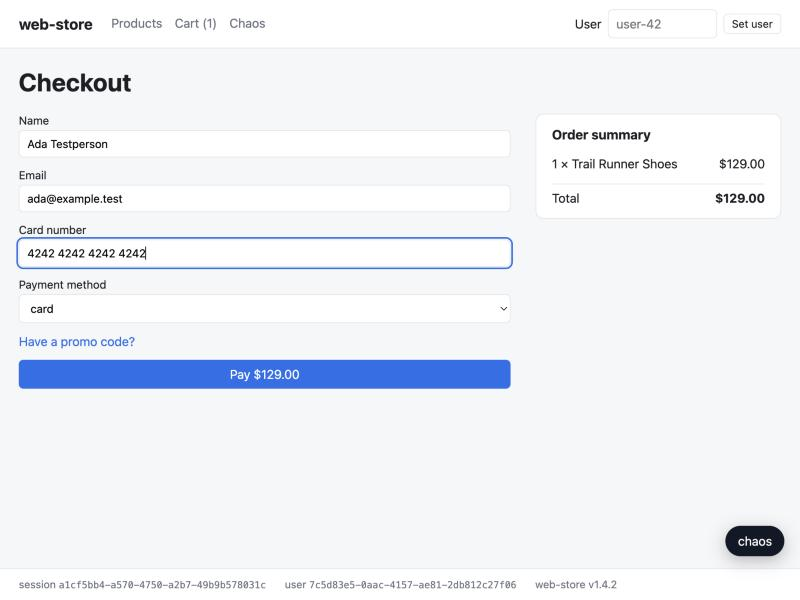
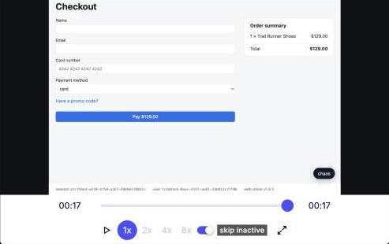
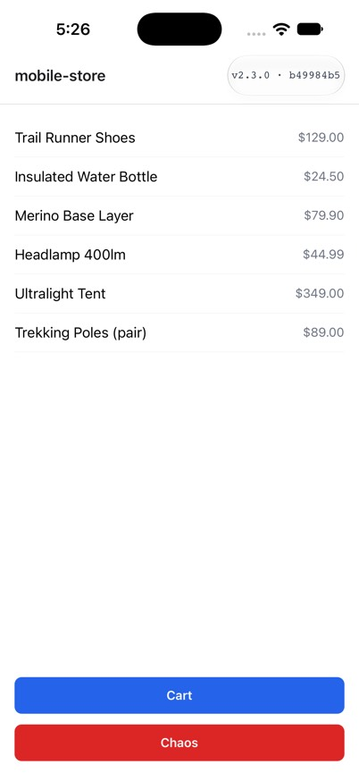
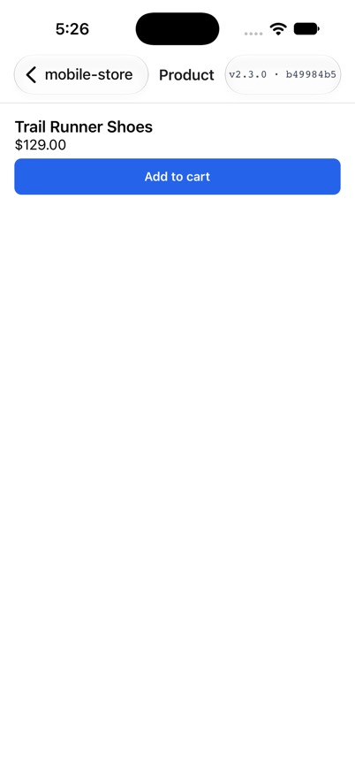
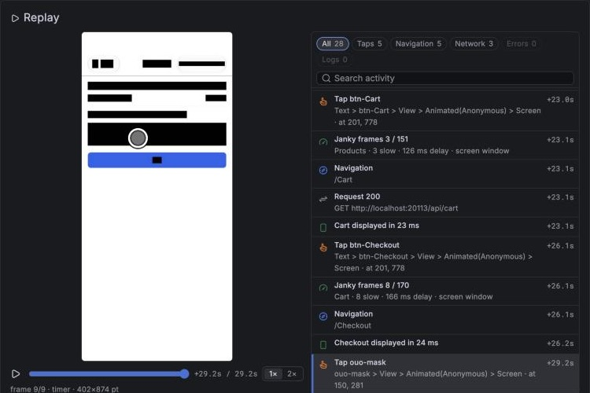
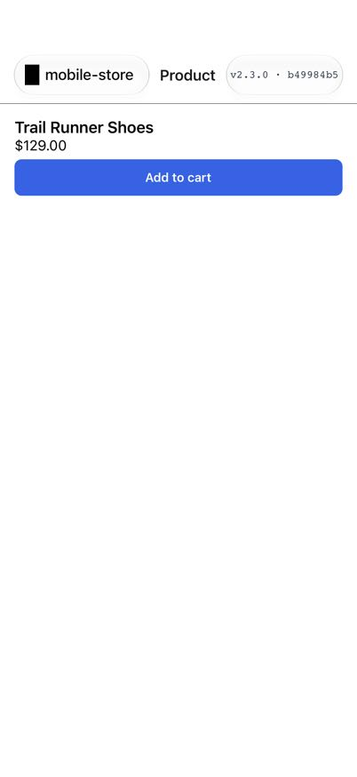
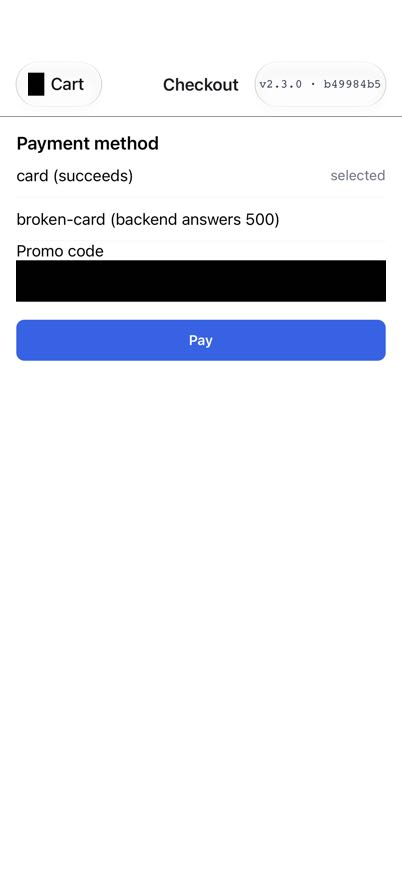

# Masking proof: what a replay contains (web and iOS)

What ouo's session replay records of the screen a user sees, shown side by side: the live
screen, then the same moment as stored by rum-api and played in the Grafana app. Captured on
2026-10-23 on `ouo-env 8b-retention-deletion` from this repository's SDKs and example apps
(`@ouo11y/browser`, `@ouo11y/react-native` with the `OuoReplay` iOS module), with fake data typed
by hand. Masking happens on the device, before anything is sent: what is masked never leaves
the browser or the phone, so neither the collector, rum-api nor Grafana ever holds it.

## Web (`@ouo11y/browser`, rrweb)

Defaults: every `<input>`, `<textarea>` and `<select>` value is masked (`replay.maskAllInputs: true`).
Elements with class `ouo-mask` have their text replaced by asterisks, elements with class
`ouo-block` are not recorded at all (a placeholder of the same size). Page text that is not
user input (headings, product names, prices, placeholders) is recorded.

| Live page (what the user saw) | Replay in Grafana (end of the session) |
|---|---|
|  |  |

Typed: `Ada Testperson`, `ada@example.test` and the card test number `4242 4242 4242 4242`
(session `a1cf5bb4…`, examples/ouo-web, Chromium). The replay shows the fields without their
values. In the stored events (`GET /v1/sessions/{id}/replay/events`, 33 rrweb events) the four
input events carry only asterisks (`*`, `**************`, `****************`,
`*******************`); `Ada`, `Testperson` and `example.test` occur nowhere, and `4242 4242`
occurs only as the card field's `placeholder` attribute, which is page markup, not user input.

## iOS (`@ouo11y/react-native` + `OuoReplay`, JPEG frames)

Defaults: `maskText`, `maskInputs`, `maskImages`, `maskWebViews` all `true`. Every label, React
Native `<Text>`, text input, image and web view is painted black on the device before the frame
is encoded (`sdk/ios/README.md` lists the classes). `testID="ouo-unmask"` keeps a view readable,
`testID="ouo-mask"` redacts one whatever the options say. The example app marks the product title
`ouo-unmask` and the promo-code field `ouo-mask`.

Recorded with the SDK defaults (`replay: { enabled: true }`, session `19e3f5dd…`, iOS 27
Simulator, frames as stored by rum-api, `GET /v1/sessions/{id}/replay/frames`):

| Live screen | Stored frame |
|---|---|
|  |  |
|  |  |
|  |  |

The same replay in the Grafana app, at its last frame (the tap on the `ouo-mask` promo field is
the touch indicator):

What the frames show:

- No text the user saw or typed is readable except the view marked `ouo-unmask`; the
  navigation-bar back chevron (an image) is masked too.
- `ADA SECRET` typed into the promo code appears in no frame. The recorder drops a frame whose
  redacted image equals the previous one, so typing into a field that is already a black box
  adds no frame at all: the recording has 9 frames, the last one taken before the typing.
- The software keyboard, including its suggestion bar (which echoed `SECRET` on the live
  screen), is in none of the frames.
- The replay is flagged `masked: true` per chunk and for the session.

**Opting out of label masking.** `examples/ouo-mobile` ships with `maskText: false` so its demo
replays stay readable. Inputs and images stay masked, and `ouo-mask` still applies (session
`b49984b5…`, same build otherwise):

| Product page, `maskText: false` | Checkout, `maskText: false` |
|---|---|
|  |  |

## Reproduce

1. `deploy/envs/ouo-env up <env>`.
2. Web: `examples/ouo-web/scripts/run.sh --env <env>` builds the app; serve `examples/ouo-web/dist`
   (`npx vite preview --port 4173`), type into the checkout form, open the session in the ouo11y
   RUM app, and check `GET /v1/sessions/{id}/replay/events` for your values.
3. iOS: `examples/ouo-mobile/scripts/build-ios.sh --env <env> --device <simulator udid>` (set
   `replay: { enabled: true }` in `examples/ouo-mobile/src/rum.ts` for the defaults), drive the
   app, background it to flush, and decode the frames from `GET /v1/sessions/{id}/replay/frames`
   (`jpeg` is base64).

## Limits of this proof

- The iOS Simulator, not a physical iPhone (the device was in use for benchmarks). The redaction
  runs in the same Swift code on a device; a device capture is not part of this proof.
- Masking is by view class and test id. A custom view that draws text itself (a chart, a
  canvas, a custom-drawn label) is not a known class: add its class to `maskClasses` or mark it
  `ouo-mask`. On the web, text rendered into a `<canvas>` is not recorded (canvas recording is
  off), but text in ordinary elements is, unless it carries `ouo-mask` or `ouo-block`.
- Telemetry other than replay (event attributes, URLs, span attributes) is not masked by these
  options; what the app puts there is what is sent.

A data processing agreement template is legal material and lives outside this repository.
